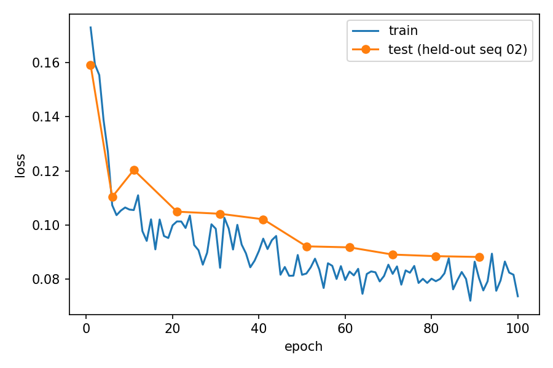
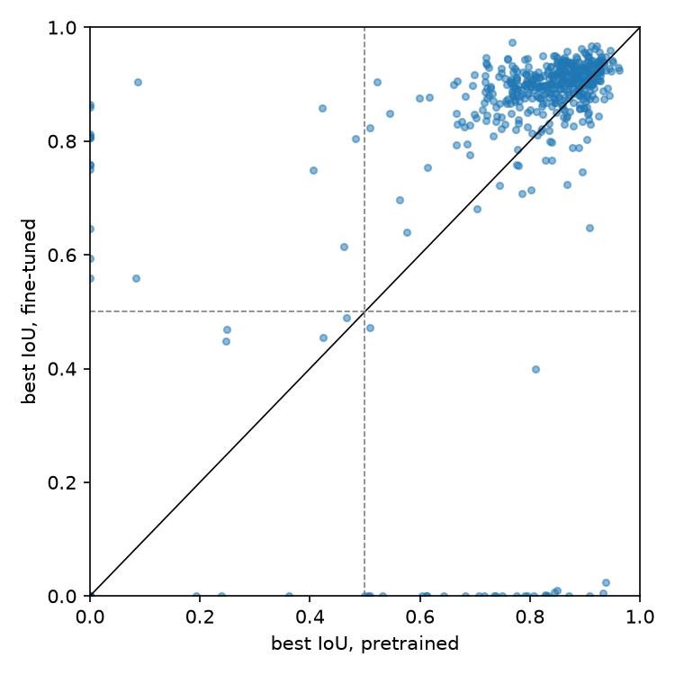
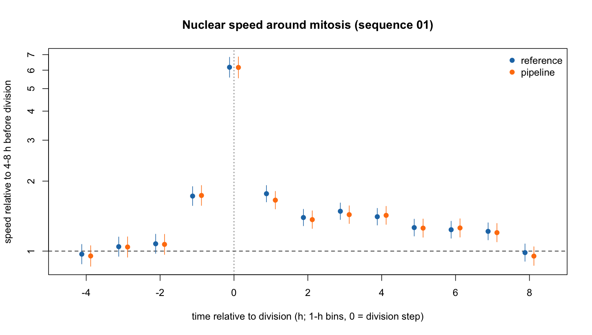

# ctc-hela-dl-tracking

Deep-learning segmentation and tracking of HeLa nuclei from the
[Cell Tracking Challenge](https://celltrackingchallenge.net), followed by a
statistical analysis of nuclear motion in R.

> **Status:** stages 1–3 complete (segmentation, tracking, statistics); documentation in progress.

**Key results (sequence 01, unseen during training)**
- Fine-tuning Cellpose-SAM on silver-truth data of the other sequence raises F1 on fully annotated frames to
  0.97–0.99 (pretrained 0.92–0.96) and improves nuclear outlines, especially around divisions (paired mixed model).
- Trackastra on these masks reaches TRA 0.95 (0.995 on silver-truth masks); divisions F1 0.79.
- Nuclear speed rises sharply at division (6.2× baseline at the division step) and stays elevated for ~7 h in the
  daughters. The automatic pipeline reproduces the reference result in all 13 time bins.

## Questions

1. How well does a pretrained deep-learning model (Cellpose-SAM) segment H2B-GFP-labelled HeLa nuclei
   compared with the challenge reference annotations, and does fine-tuning on this dataset improve the result?
2. Does nuclear speed change around mitosis, and does an automatic pipeline reach the same conclusion
   as the manual reference?
3. *(side question, later)* How does H2B-GFP content change over the cell cycle, and how much of the
   variation lies between cell families rather than within cells? A first exploration is in notebook 02.

## Data

**Fluo-N2DL-HeLa** (training set) from the Cell Tracking Challenge:
HeLa cells stably expressing H2B-GFP, Mitocheck Consortium.
Olympus IX81, 10x/0.4, pixel size 0.645 × 0.645 µm, time step 30 min.

The data are **not** included in this repository. Download them from the
[2D+Time datasets page](https://celltrackingchallenge.net/2d-datasets/) and unpack into `data/raw/`.

## Workflow

| Stage | Tools | Status |
|---|---|---|
| 1. Orientation: inspect data | Python, napari | done |
| 2. Segmentation: pretrained model, evaluation against reference, fine-tuning | Cellpose-SAM, Kaggle (GPU), R (lme4) | done |
| 3. Tracking and statistics | Trackastra, traccuracy, R (lme4) | done |
| 4. Documentation | — | planned |

## Results – stage 2: segmentation

All evaluations use **sequence 01** (gold truth, 28 annotated frames); fine-tuning used **sequence 02** only.

**Gold truth coverage.** Only frames 13 and 52 are fully annotated; the other 26 frames contain selected,
often difficult nuclei (e.g. mitotic figures). Precision/recall/F1 are therefore computed on frames 13 and 52 only;
on all frames a SEG-like score (mean IoU per annotated nucleus) is used ([notebook 02](notebooks/02_explore_dataset.ipynb)).

**Pretrained Cellpose-SAM** (`cpsam_v2`, no training on this dataset) – [notebook 03](notebooks/03_evaluate_cellpose.ipynb):
F1 0.92 (frame 13) and 0.96 (frame 52); IoU of matched nuclei 0.84–0.87.

**Fine-tuned Cellpose-SAM** (silver truth of sequence 02, 100 epochs, 127 min on a Kaggle T4) –
[notebook 04](notebooks/04_finetune_cellpose_kaggle.ipynb):

| Frame | Model | Precision | Recall | F1 | IoU (matched) |
|---|---|---|---|---|---|
| 13 | pretrained | 0.93 | 0.92 | 0.92 | 0.84 |
| 13 | fine-tuned | 1.00 | 0.93 | 0.97 | 0.91 |
| 52 | pretrained | 0.93 | 0.98 | 0.96 | 0.87 |
| 52 | fine-tuned | 1.00 | 0.97 | 0.99 | 0.91 |



**Paired per-nucleus comparison** (491 annotated nuclei, 28 frames) – [notebook 05](notebooks/05_per_nucleus_comparison.ipynb),
[R script](R/01_paired_comparison.R), [output](results/r_paired_comparison_output.txt):

- *Detection* (IoU > 0.5) does not change convincingly: 28 nuclei lost, 18 gained (exact McNemar p = 0.18).
- *Outline quality* (431 nuclei found by both models): linear mixed model on paired differences of logit(IoU)
  with a random intercept for frame. Fine-tuning improves outlines by **+0.43 (95 % CI 0.31–0.55)** on the logit
  scale – e.g. IoU 0.85 → 0.90; 80 % of nuclei improve. Frames explain 17 % of the variance; ignoring this
  clustering (t-test) would give a CI about half as wide.
- *Near divisions* (≤ 1 h from birth or division) the improvement is larger by **+0.35 (95 % CI 0.23–0.48)**,
  robust to the threshold (0.5–1.5 h: +0.31 to +0.35).
- The 28 lost nuclei are **all present in the silver truth** of sequence 01 (median IoU 0.82), so the losses are
  not explained by the model learning omissions of the silver truth.



**Limitations.** The fine-tuned model learns the outline style of the silver truth (automatic consensus), not of the
manual annotation. The near-division threshold is an assumption. Detection counts treat nuclei of one frame as
independent. Data: Kaggle mirror of the CTC training set, used while the official server was unreachable.

## Results – stage 3: tracking and speed around mitosis

**Tracking** – [notebook 06](notebooks/06_tracking_trackastra.ipynb): all 92 frames of sequence 01 segmented with the
fine-tuned model, linked with Trackastra (pretrained `general_2d`, greedy linking with divisions), evaluated with
traccuracy against the manual tracking reference ([metrics](results/tracking_metrics_seq01.csv)).

| Masks | DET | LNK | TRA | Division F1 | Division precision | Division recall |
|---|---|---|---|---|---|---|
| fine-tuned Cellpose-SAM | 0.951 | 0.942 | 0.950 | 0.79 | 0.83 | 0.76 |
| silver truth (comparison) | 0.995 | 0.992 | 0.995 | 0.88 | 0.85 | 0.92 |

Linking itself is close to challenge level (TRA 0.995 on near-perfect masks); the remaining gap comes mainly from
segmentation. Detected divisions are always placed in the correct frame (frame buffer 0–2 makes no difference).

**Speed around mitosis** – [notebook 07](notebooks/07_speed_around_mitosis.ipynb),
[R script](R/02_speed_around_mitosis.R), [output](results/r_speed_output.txt).
Speed = displacement of the nuclear centroid between consecutive frames (µm/h), aligned to each division
(94 divisions in the reference). Model: `log(speed + 0.5) ~ time bin + (1 | division) + (1 | track)`,
crossed random effects because a cell can belong to the division it arises from and to its own division.
Baseline: 4–8 h before division (≈ 2.7 µm/h).

| Time to division | −4 to −2 h | −1 h | division step | +1 h | +2 to +7 h | +8 h |
|---|---|---|---|---|---|---|
| Speed vs. baseline (reference) | 0.97–1.08 | 1.7× | 6.2× | 1.8× | 1.2–1.5× | 0.99 |

- No change in the hours before division, a sharp peak at division (daughter separation, ~8 µm in 30 min) and
  elevated motion of the daughters for about 7 h.
- **The pipeline reproduces the reference** (86 detected divisions, including some false ones): correlation of the
  time effects r = 1.00, same peak, same conclusion in 13 of 13 time bins → the pipeline is suitable for this
  question on new, unannotated data.



**Limitations.** Centroid displacement includes shape changes (chromatin condensation before division) and is not
necessarily cell migration. 13 time bins are compared with the baseline without multiplicity correction (effects are
large); confidence intervals are Wald approximations. One sequence only; the second sequence was used for training.

## Repository layout

```
data/        raw data (not tracked by git)
notebooks/   Jupyter notebooks, one per analysis step
scripts/     reusable Python scripts
R/           statistical analysis in R
results/     tables and figures
```

## Environment

Local analysis runs in a conda environment (Miniforge, Python 3.12) on macOS (Apple Silicon):

```bash
conda env create -f environment.yml
conda activate bia
```

Model training runs in Google Colab.

## License and acknowledgements

Code in this repository: MIT License (see `LICENSE`).
The dataset belongs to its providers; see the Cell Tracking Challenge terms of use.
Pretrained Cellpose models are trained on data licensed CC-BY-NC and are not redistributed here.
